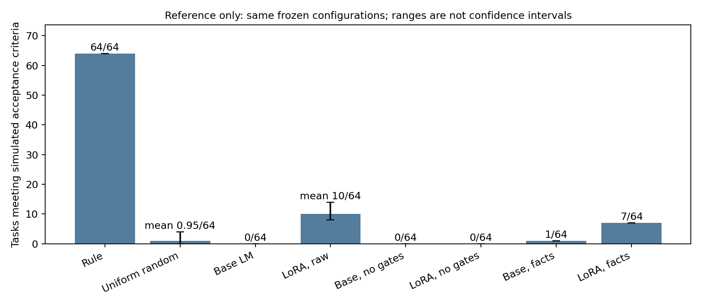

# Evidence-Grounded Integration Support

NeuralSeek internship: September–October 2026. The [test manifest](test_selection_manifest.json) for the reference results below was locked on 19 November 2026.

This reference implementation diagnoses simulated integration problems based on publicly documented NeuralSeek configuration and response formats. It gathers evidence, checks supported failure modes, and assembles a support ticket draft with the facts that justify the diagnosis or handoff.

The [policy](agent_v2.py) reads the diagnostic state and chooses one of 18 typed actions. A compact instruction model scores the allowed next-action labels. The controller applies candidate eligibility and repeat limits, runs deterministic checks, and requires evidence before accepting a terminal action. [Ticket assembly](packets_v2.py) converts the checked trace into a diagnosis or handoff draft.



## Held-out simulation results

| Policy | Successful views out of 64 |
| --- | ---: |
| Base model, constrained action interface | 0 |
| LoRA, seed 7 | 8 |
| LoRA, seed 11 | 8 |
| LoRA, seed 19 | 14 |
| Deterministic rule baseline | 64 |

The sealed set contains 64 views of 32 held-out configuration groups. All model successes came from single-fault cases. The model policies did not resolve normal cases, compound failures or appropriate handoffs on this split. The rule baseline resolved the known cases and handed off all eight unknown views. [Aggregate records](results/sealed_test.json) and the [test split](data/test.jsonl) preserve the denominators.

The local action service uses simulated exports. Archived runs use the test hash recorded in the [cohort seal](data/protocol_seal.json).

## Run the rule baseline

Use Python 3.12 from the repository root. The rule path uses the Python standard library.

```bash
python agent_v2.py verify --data data --out runs/local_verify.json
python agent_v2.py evaluate --cases data/test.jsonl --policy rule --out runs/local_rule
```

The first command checks the sealed split, grouping and action coverage. The second writes a summary and synthetic action traces. For the learned path, install the pinned dependencies in a virtual environment and fetch the fixed [Qwen2.5-0.5B-Instruct](https://huggingface.co/Qwen/Qwen2.5-0.5B-Instruct) snapshot.

```bash
python -m venv .venv
source .venv/bin/activate
python -m pip install -r requirements.txt
python download_base_v2.py --out runs/base_model
python train_policy_v2.py --data data --out runs/local_seed7 --model runs/base_model \
  --seed 7 --steps 240 --checkpoints 120,240
python agent_v2.py evaluate --cases data/val.jsonl --policy lm \
  --model runs/base_model --adapter runs/local_seed7/step_240 --out runs/local_seed7_val
```

Run the same procedure with seeds 11 and 19. Select checkpoints on validation before scoring the sealed test. The [study script](analyze_v2_study.py) recomputes aggregate metrics once the runs in the [study map](run_map_v2.json) have generated their traces. The [local HTTP service](serve_policy_v2.py) exposes typed next-action proposals.
